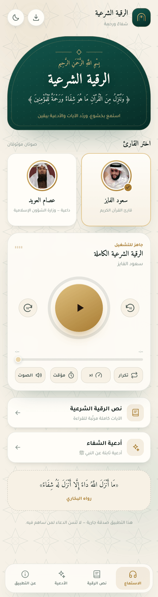
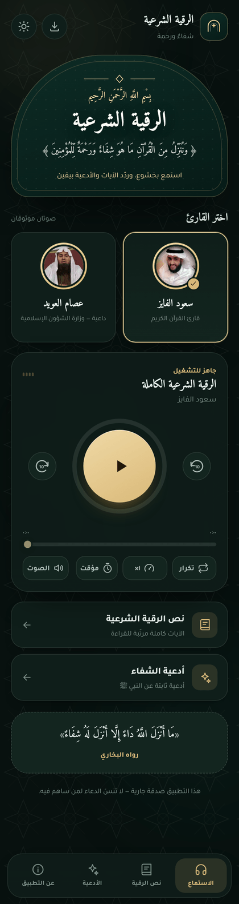

# الرقية الشرعية — تطبيق الاستماع والقراءة

تطبيق ويب (PWA) عربي بالكامل للرقية الشرعية: استماع إلى الرقية بصوت الشيخ **سعود الفايز** والشيخ **عصام العويد**، وقراءة نص الرقية الشرعية كاملًا، مع أدعية الشفاء الثابتة.

صُمّم ليكون خفيفًا وسريعًا ويعمل دون اتصال بعد أول زيارة، بتجربة مصمّمة للهاتف أولًا.

| الوضع النهاري | الوضع الليلي |
| --- | --- |
|  |  |

---

## أبرز الميزات

- **مشغّل صوت واحد فقط لكل التطبيق** — يستحيل أن يعمل صوتان في وقت واحد (هذا كان أصل المشكلة في النسخة القديمة).
- **مشغّل حقيقي**: تشغيل/إيقاف، تقديم وتأخير ١٠ ثوانٍ، شريط موضع، سرعة القراءة (٠٫٧٥× – ١٫٥×)، تكرار المقطع، **مؤقت نوم**، تحكّم من شاشة القفل (Media Session)، تشغيل في الخلفية.
- **استئناف من حيث توقفت** تلقائيًا لكل قارئ.
- **نص الرقية الشرعية** كاملًا: ١٩ قسمًا مرتّبة، النص القرآني من نسخة عثمانية موثّقة، مع عدد التكرار، وعلامة «تمّت القراءة» ونسبة تقدّم محفوظة على الجهاز.
- **أدعية الشفاء** مع ذكر المرجع لكل دعاء.
- **وضع نهاري وليلي** يتذكّر اختيارك.
- **PWA**: تثبيت على الشاشة الرئيسية + عمل دون اتصال للواجهة والنصوص.
- **بلا حساب، بلا تتبّع، بلا إعلانات.**

## الهوية البصرية

- ألوان: زمردي غامق + ذهبي دافئ + عاجي هادئ (وضع ليلي بمزاج السكينة).
- خطوط: **Amiri** للنصوص القرآنية والعناوين، **Tajawal** للواجهة — مستضافة محليًا (لا اعتماد على Google Fonts).
- زخرفة هندسية إسلامية خفيفة، وقوس محراب في الواجهة الرئيسية.
- كل الألوان معرّفة كمتغيّرات CSS في `src/styles/index.css` لتسهيل استبدال النظام البصري لاحقًا.

## التقنية

| العنصر | التقنية |
| --- | --- |
| الإطار | React 19 + TypeScript |
| البناء | Vite |
| التوجيه | React Router (SPA) |
| التنسيق | CSS مخصّص بنظام تصميم (متغيّرات) — بلا أُطر CSS |
| الصوت | HTMLAudioElement واحد + Media Session API |
| PWA | `public/manifest.webmanifest` + `public/sw.js` (مكتوب يدويًا) |
| الاستضافة | Cloudflare Pages (بناء ثابت) |

## التشغيل محليًا

```bash
npm install
npm run dev        # تشغيل التطوير على http://localhost:5173
npm run build      # بناء الإنتاج إلى مجلد dist
npm run preview    # معاينة بناء الإنتاج
```

### توليد الأيقونات (عند تغيير الشعار)

```bash
npm install -D sharp
npm run icons
```

## فحص آلي (اختياري للمطوّر)

النصوص تُختبر عبر متصفح Edge/Chrome بلا واجهة:

```bash
npm run preview -- --port 4173          # في نافذة أولى
npm run qa                             # لقطات + قياسات + أخطاء الكونسول
npm run qa:flow                        # ١٩ فحصًا وظيفيًا تفاعليًا
```

> لقطات الفحص تُحفظ في مجلد `../shots` بجانب المشروع.

## النشر على Cloudflare Pages

**الطريقة الموصى بها (ربط المستودع — نشر تلقائي عند كل رفع):**

1. ادخل إلى [Cloudflare Dashboard](https://dash.cloudflare.com/) ← **Workers & Pages** ← **Create** ← **Pages** ← **Connect to Git**.
2. اختر مستودع GitHub: `Gamingmonster2/muslim` والفرع `main`.
3. إعدادات البناء:
   - **Framework preset**: `None`.
   - **Build command**: `npm ci --include=dev && npm run build`
   - **Build output directory**: `dist`
   - **Environment variable**: `NODE_VERSION = 24`
4. اضغط **Save and Deploy**، وبعد دقيقة ستحصل على رابط `*.pages.dev`.

**بديل (رفع مباشر من جهازك):**

```bash
npm run build
npx wrangler pages deploy dist --project-name ruqyah-shariyyah
```

📘 دليل مفصّل لربط النطاق المخصّص: [docs/DEPLOY.md](docs/DEPLOY.md)

## بنية المشروع

```
muslim/
├── public/
│   ├── icons/            أيقونات PWA (SVG + PNG)
│   ├── images/sheikhs/   صور القارئين
│   ├── manifest.webmanifest
│   ├── sw.js             عامل الخدمة (عمل دون اتصال)
│   ├── _redirects        توجيه SPA على Cloudflare
│   └── _headers          رؤوس الأمان والكاش
├── scripts/
│   ├── fetch-quran.mjs   جلب النص القرآني الموثّق وتوليد البيانات
│   ├── gen-icons.mjs     توليد أيقونات PNG من SVG
│   ├── qa.mjs            فحص بصري/قياسات
│   └── qa-flow.mjs       فحص وظيفي تفاعلي
├── src/
│   ├── app/              الهيكل، الرأس، التبويبات، المشغّل المصغّر
│   ├── components/       مكوّنات مشتركة (أيقونات، إشعار)
│   ├── core/
│   │   ├── audio/        محرّك الصوت الواحد (القلب)
│   │   ├── format.ts     تنسيق الأرقام والوقت
│   │   ├── storage.ts    تخزين محلي آمن
│   │   └── useInstallPrompt.ts
│   ├── features/ruqyah/
│   │   ├── components/   المشغّل الكبير + اختيار القارئ
│   │   ├── data/         الشيوخ، الأقسام، الأدعية، النص القرآني
│   │   └── pages/        الاستماع، النص، الأدعية، عن التطبيق
│   └── styles/index.css  نظام التصميم
└── docs/
    ├── DEPLOY.md         دليل النشر وربط النطاق
    ├── PLAN.md           خطة المراحل التالية
    └── screenshots/      لقطات الواجهة
```

## إصلاح مشكلة «تشغيل صوتين معًا»

في النسخة السابقة كان لكل قارئ `iframe` مستقل، وعند التبديل تُخفى الإطارات بـ CSS فقط فتبقى تعمل في الخلفية. الحل هنا:

- عنصر `<audio>` **واحد** على مستوى التطبيق كله (`src/core/audio/engine.ts`).
- تبديل القارئ = تبديل مصدر نفس العنصر، مع إيقاف ما قبله.
- كما صُحّحت بطاقات القارئين: كانت بطاقة «سعود الفايز» تُشغّل «عصام العويد» والعكس.

## المصادر

- **الصوت**: [tvQuran](https://www.tvquran.com/) — روابط صوتية مباشرة.
- **النص القرآني**: [Al Quran Cloud](https://alquran.cloud/) — نسخة `quran-uthmani`، تُجلب عبر `scripts/fetch-quran.mjs` (٧٩ آية في نص الرقية).
- **الأدعية**: الصحيحان والسنن، مع ذكر المرجع مع كل دعاء.

## تنبيه

الرقية الشرعية سبب من أسباب الشفاء، ولا تُغني عن مراجعة الطبيب المختص عند الحاجة.

## الترخيص

MIT — انظر ملف [LICENSE](LICENSE).

---

صُنع لخدمة المسلمين، وهو صدقة جارية. لا تنسَ الدعاء لمن ساهم فيه.
